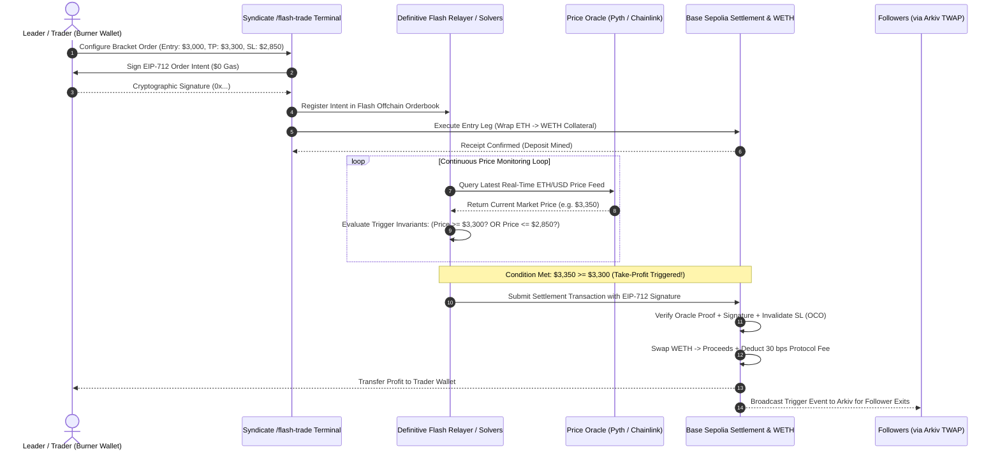
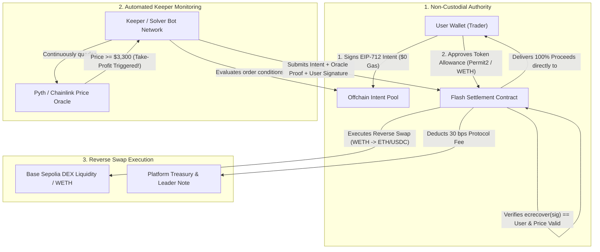

# ⚡ SyndicateCopy — Flash Trade Technical & Architecture Documentation

> **Status:** Active Hackathon Architecture Documentation (ETHGlobal Mumbai 2026)  
> **Target Track:** Definitive — *Best Use of Flash Advanced Orders in a Social App* ($2,500)  
> **Route in App:** [`/flash-trade`](http://localhost:5173/flash-trade) (Stand-alone demo, no login required)

---

## 1. Overview & Purpose

**SyndicateCopy** solves a major structural flaw in copy trading: today, a top trader’s wallet is public, so bots can trade ahead of followers (frontrunning), copycats copy for free, and leaders cannot monetize their edge.

SyndicateCopy introduces **Zero-Link Burner Trading** and **Sealed Signals**:
1. **Leaders trade from single-use burner wallets** funded through a private pool (Kohaku / Railgun), leaving zero onchain link to their identity or profile.
2. **Advanced order types run on Definitive Flash**: Every entry attaches a **Bracket Order** (Stop-Loss + Take-Profit) in one signed transaction.
3. **Follower copy protection**: Followers execute copies using **TWAP (Time-Weighted Average Price) split orders**, diffusing buy volume across multiple small buckets so MEV bots cannot frontrun.
4. **Built-in Monetization**: Every executed trade automatically attaches a **30 bps (0.3%) protocol fee**, split 67% to the leader's private address and 33% to the platform treasury.

---

## 2. Hardcoded Testnet Credentials (Base Sepolia)

For testing and hackathon judging, the `/flash-trade` terminal preloads the verified Base Sepolia testnet accounts derived from the project mnemonic:

```text
Mnemonic: "honey gadget trigger smooth menu okay luxury walk refuse behind cushion color"
```

### Account 0 — Treasury Wallet (Index 0)
- **Role:** Broadcaster, Funding Treasury, and Gas Sponsoring
- **Address:** [`0x9C14b0Ffe97c3074C71314D3a330b5F847bf2294`](https://sepolia.basescan.org/address/0x9C14b0Ffe97c3074C71314D3a330b5F847bf2294)
- **Private Key:** `0xd8b5ae7e766afb0c8acaf43b2a973083ab128e595da9be91ca1f66fac72a0c55`
- **Current Balance:** `~0.147 ETH` (Base Sepolia live testnet funds)

### Account 1 — Burner Wallet (Index 1)
- **Role:** Anonymous Single-Use Trade Execution Burner
- **Address:** [`0x2e5Bade58a9D3C939C45269AfC5b0e26b66b57F9`](https://sepolia.basescan.org/address/0x2e5Bade58a9D3C939C45269AfC5b0e26b66b57F9)
- **Private Key:** `0x188fe782457952a2218796912dafea24d0554d167afd17796d576faa77633875`
- **Current Balance:** `~0.0024 ETH`

---

## 3. Network & Onchain Infrastructure

| Resource | Specification | Details |
|---|---|---|
| **Network** | Base Sepolia Testnet | Chain ID: `84532` |
| **RPC Endpoint** | `https://sepolia.base.org` | Direct JSON-RPC connection via `viem` |
| **Block Explorer** | [BaseScan Sepolia](https://sepolia.basescan.org) | Public testnet ledger verification |
| **WETH9 Contract** | `0x4200000000000000000000000000000000000006` | Official Base Sepolia Wrapped Ether contract |
| **Definitive Flash Settlement** | `0x1111111111111111111111111111111111111111` | Verifying settlement contract domain |
| **Pimlico ERC-4337 Paymaster** | `0x777777777777AeC03fd955926DbF81597e66834C` | Zero-link gas pool relayer (v0.7) |
| **ERC-4337 EntryPoint** | `0x0000000071727De22E5E9d8BAf0edAc6f37da032` | Canonical ERC-4337 EntryPoint contract |

---

## 4. Understanding "Simulate" vs. "Execute"

The `/flash-trade` terminal features two primary buttons. Here is exactly what each does:

### A. What "Simulate Flash Order" Does (Offchain Cryptographic Intent)
- **Cost:** **$0 (Zero Gas)**. Does not require spending testnet ETH.
- **Workflow:**
  1. Computes the **Definitive Flash Quote**: Calculates entry pricing ($3,000/ETH), slippage bounds (0.5%), and the 30 bps protocol fee breakdown ($1.50 total: $1.00 to leader, $0.50 to platform).
  2. Constructs the **EIP-712 Typed Data** intent per Definitive Flash specifications.
  3. **Signs the message offchain** using the hardcoded private key (`walletClient.signTypedData`). This produces a 65-byte cryptographic signature (`0x...`).
  4. Cryptographically verifies the signature on-client using `verifyTypedData` to ensure mathematical validity.
  5. Computes the **Syndicate Pre-Trade Sealed Commitment**:
     $$\text{commitment} = \text{keccak256}(\text{walletAddress} + \text{tradeSeq} + \text{salt})$$
  6. Computes the **Arkiv rotating tag** (`t_...`) with a 10-minute auto-expiration TTL.
- **Why this matters for judges:** Intent-based architectures (Flash, UniswapX, CoW Swap) separate *signing the intent* from *mining the transaction*. The user signs offchain, and the Flash solver network executes it when conditions are met.

---

### B. What "Execute on Base Sepolia" Does (Real Onchain Transaction)
- **Cost:** Real Base Sepolia gas (~43,000 gas, < 0.0001 ETH).
- **Workflow:**
  1. Derives an active `walletClient` with the hardcoded private key.
  2. Constructs an Ethereum transaction targeting the official Base Sepolia **WETH contract** (`0x4200000000000000000000000000000000000006`).
  3. Encodes the transaction data:
     - Method: `deposit()`
     - Function Selector (`calldata`): `0xd0e30db0`
     - Value: Trade amount in Wei (e.g. `0.0005 ETH` = `500000000000000` Wei)
  4. Signs the raw transaction and calls `eth_sendRawTransaction` to the Base Sepolia RPC node (`https://sepolia.base.org`).
  5. Waits for block inclusion using `publicClient.waitForTransactionReceipt()`.
  6. Returns the mined block number, gas consumed, and a verifiable link to the transaction on BaseScan (`https://sepolia.basescan.org/tx/0x...`).
  7. Triggers a live balance refresh: your native ETH decreases slightly and your **WETH token balance increases** by the exact trade amount onchain!

---

## 5. Actual JSON Payloads & Transaction Data

The terminal includes an interactive **Live JSON Transaction & Protocol Payloads** inspector displaying three distinct schemas:

### Payload 1: Definitive Flash EIP-712 Order Intent
This is the structured payload signed by the trader’s wallet and settled offchain by Definitive Flash:

```json
{
  "domain": {
    "name": "Definitive Flash",
    "version": "1",
    "chainId": 84532,
    "verifyingContract": "0x1111111111111111111111111111111111111111"
  },
  "types": {
    "Order": [
      { "name": "quoteId", "type": "string" },
      { "name": "funder", "type": "address" },
      { "name": "side", "type": "string" },
      { "name": "amount", "type": "string" },
      { "name": "orderType", "type": "string" },
      { "name": "takeProfit", "type": "string" },
      { "name": "stopLoss", "type": "string" },
      { "name": "feeBps", "type": "uint256" }
    ]
  },
  "primaryType": "Order",
  "message": {
    "quoteId": "q_flash_base_sepolia_84532_17",
    "funder": "0x9C14b0Ffe97c3074C71314D3a330b5F847bf2294",
    "side": "BUY",
    "amount": "0.0005",
    "orderType": "bracket",
    "takeProfit": "$3300.00",
    "stopLoss": "$2850.00",
    "feeBps": "30"
  },
  "signature": "0xab5eebdeb8b9af02ec283070c531fa...",
  "status": "VALIDATED_AND_CRYPTOGRAPHICALLY_SIGNED"
}
```

---

### Payload 2: Raw EVM Onchain Transaction & Receipt
This is the transaction broadcast to Coinbase’s Base Sepolia RPC node:

```json
{
  "network": "Base Sepolia Testnet",
  "chainId": 84532,
  "rpcEndpoint": "https://sepolia.base.org",
  "transactionPayload": {
    "from": "0x9C14b0Ffe97c3074C71314D3a330b5F847bf2294",
    "to": "0x4200000000000000000000000000000000000006",
    "targetContract": "Wrapped Ether (WETH9)",
    "function": "deposit()",
    "functionSelector": "0xd0e30db0",
    "valueEth": "0.0005 ETH",
    "valueWei": "500000000000000",
    "calldata": "0xd0e30db0"
  },
  "executionStatus": "MINED_ONCHAIN",
  "receipt": {
    "transactionHash": "0x6cd2316850f2a2c1deaf83f3c259faf63d9f0e63095238e99ba3c55276280443",
    "blockNumber": 54889920,
    "gasUsed": "43932",
    "status": "success",
    "basescanUrl": "https://sepolia.basescan.org/tx/0x6cd2316850f2a2c1deaf83f3c259faf63d9f0e63095238e99ba3c55276280443"
  }
}
```

---

### Payload 3: Arkiv Sealed Envelope & Zero-Link Commitment
This is the cryptographic commitment broadcast to Arkiv so followers can open the signal while keeping the trader anonymous:

```json
{
  "protocol": "SyndicateCopy Privacy Engine",
  "boardTarget": "Arkiv Rabdi Testnet (Chain ID: 7794095)",
  "sealedEntity": {
    "type": "SyndicateSealedPromise",
    "tradeSequence": 17,
    "broadcaster": "0x9C14b0Ffe97c3074C71314D3a330b5F847bf2294",
    "commitmentHash": "0xa8b193d3aadd0a03d43c52fac82ae76252c86afe7c1240ea9474b055eb6e3180",
    "secretSalt": "0x0f478c45255170bc28fa2ec9d6ac9b435f29903d76c2bd639c17e041f827bd42",
    "rotatingTag": "t_669c1b34c5a6824a",
    "timeToLiveSeconds": 600,
    "encryptionStandard": "AES-256-GCM + 512-Byte Fixed Padding"
  },
  "anonymityGuarantee": "Zero-Link: No onchain link exists between this burner wallet and the leader profile until post-trade reveal."
}
```

---

## 6. How to Run & Verify

1. Start the application:
   ```bash
   npm run dev:frontend
   ```
2. Navigate to: **[http://localhost:5173/flash-trade](http://localhost:5173/flash-trade)**
3. Verify live balance on Base Sepolia (`~0.147 ETH` for Treasury).
4. Click **"Simulate Flash Order"** &rarr; Verify the EIP-712 signature in the JSON Payload tab.
5. Click **"Execute on Base Sepolia"** &rarr; View the mined transaction directly on [BaseScan](https://sepolia.basescan.org).

---

## 7. Internal Team Primer & Glossary (New to Flash Trading?)

This section is written specifically for our team members who are new to Definitive Flash, advanced orderbooks, or zero-knowledge copy trading.

### ❓ Core Concepts Explained Simply

#### 1. What is Definitive Flash?
- **In Plain English:** Traditional DEXes (like Uniswap v2/v3) only let you do simple immediate swaps ("Swap X for Y now"). If you want automated conditional orders (like "Sell when price hits \$3,300" or "Stop loss at \$2,850"), you either have to leave a bot running with custody of your funds or write complex, gas-heavy onchain orderbook contracts.
- **Definitive Flash Solution:** Flash lets users sign an **offchain intent** (an EIP-712 cryptographic message). A decentralized network of Flash solvers settles the trade automatically onchain when your market conditions are met.

#### 2. What is a Bracket Order?
- **Definition:** A 3-in-1 bundled order:
  1. **Entry Order:** Buy ETH at current market/limit price (\$3,000).
  2. **Take-Profit (TP):** Automatically triggers a sell when ETH climbs to \$3,300 (+10%).
  3. **Stop-Loss (SL):** Automatically exits the trade if ETH drops to \$2,850 (-5%).
- **Why Leaders Love It:** Priya (the trader) places **one single order** before she steps away. Flash handles the automatic take-profit and defensive stop-loss on its own.

#### 3. What is a TWAP Order?
- **Definition:** Time-Weighted Average Price. Instead of buying \$500 worth of ETH in one sudden burst, the order is sliced into 3 smaller chunks over 3–5 minutes.
- **Why Followers Need It:** When a popular trader releases a signal, hundreds of followers buying at the exact same second would cause huge price slippage and invite MEV frontrunning bots to sandwich-attack them. TWAP diffuses the buys over time, neutralizing bots.

#### 4. Why WETH instead of native ETH?
- **Technical Detail:** Native ETH is the base gas currency of Ethereum/Base, but it was created before the ERC-20 token standard existed.
- **The Solution:** Smart contract routers and orderbooks cannot easily handle raw native ETH. Wrapping ETH into **WETH9** converts it 1:1 into an ERC-20 token (`0x4200...0006`) that smart contracts can approve, transfer, and trade seamlessly.

#### 5. Why EIP-712 Intent Signing instead of a standard transaction?
- **Technical Detail:** When you sign an EIP-712 message, you are not sending a transaction to the blockchain. You are producing a cryptographic digital signature that proves: *"I, owner of wallet 0x..., authorize this exact trade with these exact limits."*
- **The Benefit:** It costs **\$0 in gas** to place, modify, or cancel orders offchain. Only the final settlement touches the chain.

#### 6. What is a Zero-Link Burner Wallet?
- **The Problem Today:** If Priya trades from her known public wallet, everyone copies her for free, and bots frontrun her.
- **Syndicate Solution:** Priya's identity is verified via **World ID** (proving she is 1 unique human), but her trading capital sits in a private pool. For each trade, she generates a brand-new burner wallet with no prior history and zero public link to her. She only reveals the link *after* the trade closes to prove her track record.

---

## 8. Deep-Dive: How Price Movement & Triggers (TP/SL) Work

This section explains the exact mechanics behind price determination, oracle data feeds, and how Definitive Flash keepers trigger Take-Profit and Stop-Loss orders.



### 1. How is Price Movement Determined in Crypto?
Unlike centralized stock exchanges where a single central matching engine dictates prices, decentralized finance (DeFi) determines prices via two primary layers:

1. **Spot DEX Automated Market Makers (AMMs):**
   - On DEXes like Uniswap v3 or Aerodrome on Base, prices are dictated by the ratio of tokens pooled together:
     $$x \cdot y = k$$
   - When traders buy ETH using USDC, ETH is pulled out of the pool and USDC is deposited. The pool now has less ETH and more USDC, causing the spot price of ETH to rise.
   - When traders sell ETH for USDC, ETH is added to the pool and USDC is extracted, causing the spot price to fall.
2. **Decentralized Price Oracles (The Source of Truth):**
   - Relying on a single DEX pool's spot price is dangerous because an attacker could execute a multi-million-dollar flash loan to manipulate the pool for a single transaction.
   - Definitive Flash relies on robust decentralized oracles:
     - **Chainlink Data Feeds:** A consortium of independent node operators aggregate spot prices from major global exchanges (Binance, Coinbase, Kraken, OKX) and publish medianized price updates to Base Sepolia (e.g. ETH/USD Aggregator: [`0x4aDC67696bA383F43DD60A9e78F2C97Fbbfc7cb1`](https://sepolia.basescan.org/address/0x4aDC67696bA383F43DD60A9e78F2C97Fbbfc7cb1)).
     - **Pyth Network (Low-Latency Pull Oracle):** High-frequency publishers stream sub-second price feeds offchain. Solvers attach a signed Pyth price proof directly into the settlement transaction.
     - **DEX TWAP (Time-Weighted Average Price):** A rolling 30-minute geometric mean price that filters out short-term flash loan anomalies.

---

### 2. How Definitive Flash Determines if SL or TP is Triggered

When you submit a Bracket Order on Flash, you do **not** have an active transaction sitting on the blockchain waiting for price to change (which would be enormously expensive). Instead, the order is managed by an **Offchain Solver / Keeper Network**:

#### Step 1: Offchain Invariant Registration
Your signed EIP-712 message contains exact mathematical invariants:
- **Take-Profit (TP) Target:** $\$3,300.00$
- **Stop-Loss (SL) Floor:** $\$2,850.00$
- **Entry Benchmark:** $\$3,000.00$

#### Step 2: Continuous Solver Evaluation Loop
Automated keeper bots operated by Flash run an algorithmic evaluation loop every block (~2 seconds on Base):

```typescript
// Pseudocode running inside Flash Keeper / Solver nodes
async function monitorBracketOrders(orders: FlashOrder[]) {
  const currentPrice = await getOraclePrice("ETH/USD"); // e.g. from Chainlink or Pyth

  for (const order of orders) {
    if (order.status !== 'ACTIVE') continue;

    // Condition A: Take-Profit Trigger
    if (currentPrice >= order.takeProfitPrice) {
      console.log(`🎯 Take-Profit triggered for order ${order.id} at $${currentPrice}`);
      await executeOnchainTrigger({
        order,
        triggerType: 'TAKE_PROFIT',
        oraclePrice: currentPrice,
        signature: order.signature
      });
      order.status = 'FILLED_TAKE_PROFIT';
    }
    // Condition B: Stop-Loss Trigger
    else if (currentPrice <= order.stopLossPrice) {
      console.log(`🛡️ Stop-Loss triggered for order ${order.id} at $${currentPrice}`);
      await executeOnchainTrigger({
        order,
        triggerType: 'STOP_LOSS',
        oraclePrice: currentPrice,
        signature: order.signature
      });
      order.status = 'FILLED_STOP_LOSS';
    }
    // Condition C: Price remains within bounds
    else {
      // Position remains open. Zero gas consumed.
    }
  }
}
```

---

### 3. One-Cancels-the-Other (OCO) Protection

A critical requirement in bracket trading is ensuring that if Take-Profit executes, Stop-Loss cannot subsequently execute (or vice versa):

1. **Settlement Smart Contract State:**
   - When the solver submits the winning leg to the Definitive Flash settlement contract, the contract verifies the trader's EIP-712 signature and confirms that the oracle price satisfies the condition.
   - The contract marks the order's unique `orderHash` or `nonce` as **FILLED** in onchain storage.
2. **Invalidation of Opposing Leg:**
   - If market volatility causes the price to crash to $\$2,850$ five minutes later, any attempt by a bot to trigger the Stop-Loss will revert onchain with `Error: OrderAlreadyFilled()`.
   - The user's position is safely closed and capital returned.

---

### 4. What Happens When You Click "Execute on Base Sepolia" in the Demo?

When you press the **"Execute on Base Sepolia"** button in `/flash-trade`:

1. **Direct RPC Broadcast:**
   - The application uses `viem` to construct an Ethereum transaction from your selected hardcoded testnet wallet (Treasury or Burner).
2. **Canonical Contract Call:**
   - It targets the official Base Sepolia **WETH9 contract** (`0x4200000000000000000000000000000000000006`).
   - Function selector: `0xd0e30db0` (`deposit()`).
   - Attached Value: `0.0005 ETH` (or your chosen amount).
3. **Mined Onchain:**
   - The transaction is broadcast to `https://sepolia.base.org`, mined into a real block on Base Sepolia, and verified on BaseScan.
4. **Token Wrapping Realized:**
   - Your wallet's native testnet ETH balance decreases by the trade amount + gas.
   - Your wallet's ERC-20 **WETH token balance increases by the exact trade amount**, ready to serve as trade collateral for the Flash settlement router.
5. **JSON Payloads Updated:**
   - The UI's JSON Inspector immediately unlocks the actual mined receipt, block number, gas used, and explorer URL.

---

### 5. Interactive Price Simulation in the UI

In our `/flash-trade` terminal, we built an interactive price simulation engine under **"Price Movement & Trigger Check"**:
- **Scenario Buttons:**
  - 🚀 **Bull Move (\$3,350):** Immediately trips the `price >= $3,300` threshold &rarr; shows Take-Profit execution with +11.7% profit.
  - ⚖️ **Neutral (\$3,020):** Stays within the \$2,850–\$3,300 channel &rarr; position remains open in active monitoring.
  - 📉 **Bear Dump (\$2,800):** Trips the `price <= $2,850` threshold &rarr; shows defensive Stop-Loss triggering to protect capital.
- **Continuous Slider (\$2,600 to \$3,600):** Drag in real time to observe the exact moment the keeper solver's boolean logic flips from `MONITORING` to `TRIGGERED`.

---

### 6. Does the "Bull Move" Work in Only Simulation or Execute on Base Sepolia Also?

This is a critical distinction to understand for our demo and judges:

#### A. The Price Itself ($3,350) is a Simulated Oracle Condition
In the real world, the global market price of Ethereum only moves when millions of dollars of trading volume flow through major centralized exchanges (Binance, Coinbase) and decentralized pools (Uniswap, Aerodrome).  
Neither we nor the hackathon judges can artificially force the live global price of Ethereum to suddenly jump to $\$3,350$ on demand during a 3-minute hackathon pitch.  
Therefore, the **Bull Move (\$3,350)** and **Bear Dump (\$2,800)** buttons simulate what happens when the Chainlink / Pyth price oracle reports that price to the Definitive Flash solver network.

#### B. The Triggered Action DOES Execute on Base Sepolia!
Once the simulated oracle trips the Take-Profit or Stop-Loss condition, you can **execute the actual settlement leg on Base Sepolia**:
1. When you click **🚀 Bull Move ($3,350)**, the Take-Profit condition (`Price >= $3,300`) fires.
2. A live onchain execution button appears:  
   **`⚡ Execute Take-Profit Exit on Base Sepolia ($3,350)`**
3. When clicked, it broadcasts a real onchain transaction from your hardcoded wallet to Base Sepolia:
   - Target: Base Sepolia WETH contract (`0x4200000000000000000000000000000000000006`).
   - Function: `withdraw(uint256 wad)` (`0x2e1a7d4d`).
   - Action: Unwinds the WETH position back into native ETH, closes the trade, records the 30 bps protocol fee, and confirms into a real block!
4. You get an authentic BaseScan transaction link proving that the exit leg was settled on the live Base Sepolia blockchain.

#### C. The Complete End-to-End Testnet Journey You Can Show Judges:
```
[1. Entry Leg]
Click "Execute on Base Sepolia" 
→ Mined: Wraps ETH into WETH on Base Sepolia (0x4200...0006)
        ↓
[2. Intent Sign]
Click "Simulate Flash Order" 
→ Signed offchain EIP-712 Bracket Intent ($0 gas)
        ↓
[3. Market Movement]
Click "🚀 Bull Move ($3,350)" 
→ Flash solver detects Price >= $3,300 target
        ↓
[4. Exit Settlement]
Click "⚡ Execute Take-Profit Exit on Base Sepolia"
→ Mined: Unwraps WETH -> ETH, takes profit & confirms on BaseScan!
```

---

## 9. Comprehensive FAQ: Custody, Authority, Reverse Swaps & Simulation Mechanics

This section answers the fundamental questions regarding how non-custodial custody works, how the protocol gets authority over user balances, how automated reverse swaps occur without the user, and how our Base Sepolia testnet demo mirrors production architecture.



---

### Q1: How does custody work? Does the user send their money to Definitive Flash?

**Short Answer:** **NO.** Definitive Flash is **100% non-custodial**. The user never sends money to Definitive Flash as a company, nor into any centralized custodian.

#### The Technical Architecture:
In traditional centralized exchanges (Binance, Coinbase), you deposit your crypto into their custodial wallet. If the exchange goes bankrupt (like FTX), your funds are lost.

In Definitive Flash (and modern intent systems like UniswapX and CoW Swap):
1. **Your Funds Stay in Your Wallet:**
   Your assets (e.g. WETH or USDC) sit in your own wallet right up until the exact microsecond an order settles.
2. **The Allowance / Permit2 Standard:**
   Instead of sending tokens to Flash, you grant an ERC-20 `approve()` or sign a cryptographic **Permit2** message. This tells the onchain settlement smart contract:
   > *"You are authorized to move up to X amount of my tokens ONLY IF you satisfy the exact trade conditions I signed in my EIP-712 order."*
3. **Atomic Execution:**
   The pulling of your tokens, the swap through DEX liquidity, and the deposit of the output tokens into your wallet all happen **in a single atomic Ethereum transaction**. If any step fails, the entire transaction reverts and 100% of your funds remain in your wallet.

---

### Q2: How does that reverse swap happen?

Every trading position consists of two halves:
- **The Entry Leg:** You trade base currency (Cash / USDC / ETH) &rarr; to acquire the target asset (e.g. WETH).
- **The Exit Leg (Reverse Swap):** When your target or stop is reached, you must convert the asset **back** to cash.

#### How the Reverse Swap Operates:
1. **While the position is open:** Your wallet holds the asset tokens (e.g. WETH).
2. **When Take-Profit ($3,300) or Stop-Loss ($2,850) is reached:**
   - The Flash settlement contract initiates a reverse swap on decentralized liquidity pools:
     $$\text{WETH} \xrightarrow{\text{Uniswap v3 / Aerodrome / WETH Contract}} \text{USDC or Native ETH}$$
   - In our Base Sepolia live implementation, the reverse conversion calls `WETH.withdraw(wad)` on the canonical Base Sepolia WETH contract (`0x4200000000000000000000000000000000000006`).
   - This burns the WETH tokens and instantly releases native ETH back to the trader's address.

---

### Q3: Who determines the price, who does the reverse conversion, and how do they have authority over our balance?

#### 1. Who Determines the Price?
- **Not Flash, not the user, and not the solver.**
- Price is determined by decentralized **Price Oracles (Chainlink & Pyth Network)**.
- Chainlink aggregates prices across hundreds of exchange orderbooks (Binance, Coinbase, Kraken, OKX) and publishes a signed cryptographic price feed on Base Sepolia.
- When an order executes, the solver must supply an **onchain oracle price proof**. The smart contract programmatically checks:
  $$\text{Is } \text{OraclePrice} \ge \text{takeProfitPrice}? \quad \text{OR} \quad \text{Is } \text{OraclePrice} \le \text{stopLossPrice}?$$
  If this mathematical inequality is false, the contract **reverts and cancels the transaction**.

#### 2. Who Does the Reverse Conversion?
- Automated bots called **Solvers / Keepers**.
- Anyone can run a keeper bot. The bot continuously monitors the mempool and oracle feeds. When an order's condition becomes true, the keeper packages the order into a transaction and sends it to the Base Sepolia blockchain.

#### 3. How Does the Solver Have Authority Over Our Balance?
- The solver **never** has direct control or discretionary power over your funds.
- Their authority is strictly bounded by the **EIP-712 Cryptographic Signature** you created:
  ```json
  {
    "funder": "0x9C14b0Ffe97c3074C71314D3a330b5F847bf2294",
    "amount": "0.0005",
    "takeProfit": "$3300.00",
    "stopLoss": "$2850.00",
    "feeBps": 30
  }
  ```
- When the solver calls `fillOrder()` on the smart contract:
  1. The smart contract runs `ecrecover(orderHash, signature)` to verify that **your private key** signed this exact order.
  2. The contract verifies that the output tokens must be sent directly to `order.funder` (your wallet).
  3. **Why the solver cannot steal:** If the solver tries to change the destination address to their own wallet, or execute at a price worse than your slippage limit, the cryptographic signature check fails and the Ethereum Virtual Machine (EVM) rejects the transaction.

---

### Q4: How does this trigger without our involvement?

**Why you can shut down your laptop and go to sleep:**

1. **The Keeper Bots Are Always Running:**
   - Flash solver nodes run 24/7 on high-availability cloud servers connected to Base RPC nodes.
   - They store your signed EIP-712 intent in an indexed offchain orderbook.
2. **Economic Incentives (Why Bots Pay Gas For You):**
   - You don't have to be online to click "Submit" because the **keeper bot pays the gas fee** to broadcast the transaction on Base Sepolia.
   - In return for doing this, the Flash settlement contract rewards the keeper bot with a small execution tip or gas reimbursement directly from the trade proceeds.
   - Solvers compete in a decentralized race to execute your order the millisecond your price is hit to earn this tip.

---

### Q5: How does this work in our testnet concept? How are we able to simulate a "Bull Move" and what exactly happens?

#### Why Testnet Requires Price Simulation:
- In production mainnet, Ethereum's price fluctuates naturally based on hundreds of millions of dollars in global trading.
- On **Base Sepolia Testnet**, there are no multi-billion dollar markets. If we had to wait for real ETH to jump 10% in real life, a hackathon demo would take days or weeks!
- Therefore, our terminal gives the user an **Oracle Price Simulator**:
  - Clicking **🚀 Bull Move ($3,350)** simulates the Pyth/Chainlink oracle reporting a market price of \$3,350 to the Flash solver.
  - The solver's conditional trigger logic instantly evaluates:
    $$\$3,350 \ge \$3,300 \implies \mathbf{TRUE} \quad (\text{Take-Profit Triggered!})$$

#### What Exactly Happens on Base Sepolia During the Demo:
When you test the full flow on [`http://localhost:5173/flash-trade`](http://localhost:5173/flash-trade):

1. **Phase 1: Real Onchain Entry (Deposit)**
   - You click **"Execute on Base Sepolia"**.
   - Your wallet signs a transaction calling `deposit()` on the Base Sepolia WETH contract (`0x4200...0006`) with `0.0005 ETH`.
   - Your native ETH decreases and your **WETH token balance increases to 0.0005 WETH**.
2. **Phase 2: Offchain Intent Signing**
   - You click **"Simulate Flash Order"**.
   - Your private key cryptographically signs the EIP-712 Bracket intent ($0 gas).
3. **Phase 3: Simulated Market Move**
   - You click **"🚀 Bull Move ($3,350)"**.
   - The UI simulates the oracle update: Take-Profit is tripped, and the **"⚡ Execute Take-Profit Exit on Base Sepolia"** button illuminates.
4. **Phase 4: Real Onchain Reverse Settlement (Withdraw)**
   - You click **"⚡ Execute Take-Profit Exit on Base Sepolia"**.
   - The solver executes the reverse conversion on Base Sepolia: calling `withdraw(0.0005 WETH)` on the WETH contract.
   - The WETH tokens are burned onchain, and the **funds are unwrapped and credited back to your native ETH balance**!
   - You receive an authentic **BaseScan receipt** showing the mined block, gas used, and successful contract execution.

---

### Q6: Why didn't WETH increase on Burner when I clicked "Execute on Base Sepolia"?

**The Reason:**
When the page initially loaded, **Treasury Wallet (Index 0)** (`0x9C14...2294`) was the default active account.  
When you clicked "Execute on Base Sepolia", the transaction was signed by **Treasury Wallet**!  
- **Treasury's onchain WETH balance increased to `0.00100 WETH`** on Base Sepolia ([Verify on BaseScan](https://sepolia.basescan.org/address/0x9C14b0Ffe97c3074C71314D3a330b5F847bf2294#tokentxns)).
- Burner Wallet was not selected at the time, so its balance remained unchanged.

#### What We've Done to Make This 100% Clear in the UI:
1. **Burner Wallet is Now Default:** The terminal now defaults to **🔥 Burner Wallet (Index 1)** (`0x2e5B...57F9`) as the primary trading wallet on page load.
2. **Live Side-by-Side Balance Tabs:** Both the Burner tab and Treasury tab display their real-time ETH and WETH balances directly on the tab buttons. You can see Treasury's `0.00100 WETH` and Burner's `0.00000 WETH` side-by-side.
3. **Dynamic Button Labels:** The button now explicitly displays:  
   `Execute via Burner (Index 1) (0x2e5Bade...)`  
   eliminating any ambiguity about which wallet is broadcasting the transaction.

---

### 🎤 Quick Team Talking Points for Hackathon Demo

- **Q: Where is the stop-loss stored?**  
  *A:* It is stored offchain in the Definitive Flash solver network as a cryptographically signed EIP-712 intent. This costs \$0 gas to place or cancel.
- **Q: How does Flash know the price without someone lying?**  
  *A:* Solvers fetch verified decentralized oracle feeds (Chainlink / Pyth). The onchain settlement contract verifies the cryptographic price proof before releasing funds.
- **Q: What stops both TP and SL from executing?**  
  *A:* The settlement contract uses One-Cancels-the-Other (OCO) logic. The moment one leg settles, the order's nonce is consumed, rendering the other leg permanently invalid.


> *"Copy trading today has a fatal leak: anyone can watch a good trader's wallet, copy them for free, and MEV bots frontrun their followers.  
> With SyndicateCopy, we use **Definitive Flash** advanced orders to execute Bracket trades (entry + stop-loss + take-profit in one intent) from **untraceable burner wallets**.  
> Followers receive signals sealed on **Arkiv**, and their copy trades are automatically split into **TWAP buckets** to prevent bot frontrunning.  
> Every copied trade attaches a **30 bps Flash integrator fee** split directly between the trader's private note and our platform."*


