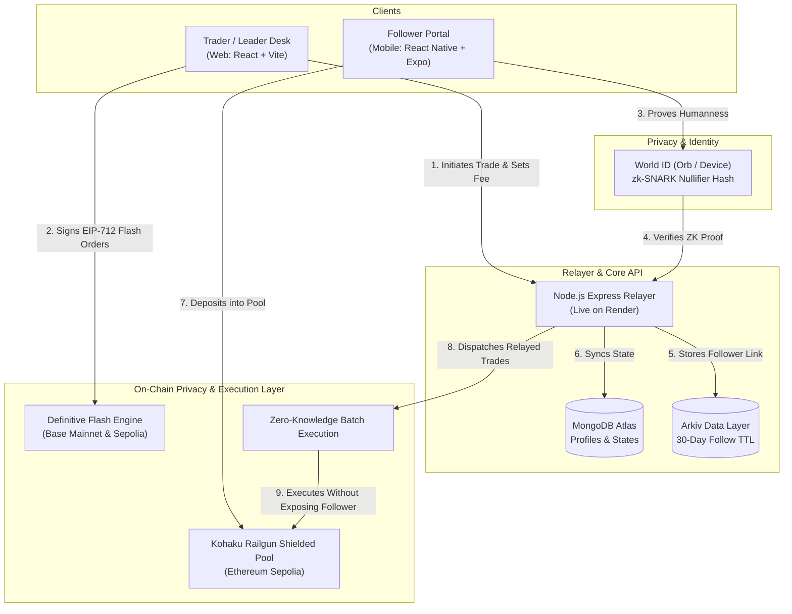

# 🛡️ Syndicate — Zero-Knowledge Copy Trading Protocol

> **Copy a trader's moves without broadcasting your capital.**  
> Built with **World ID (zk-SNARKs)**, **Kohaku (Railgun Shielded Pool)**, **Definitive Flash**, and **Arkiv**.

---

## ⚡ Quick Demo: Flash Trade Terminal (No Login Required)

Direct link: **[`http://localhost:5173/flash-trade`](http://localhost:5173/flash-trade)**

For ETHGlobal Mumbai hackathon evaluation, the **Flash Trade Terminal** lets you simulate and execute live onchain trades on Ethereum Sepolia and Base Mainnet using preloaded burner credentials without needing authentication:
- **Bracket Orders** (Entry + Take-Profit + Stop-Loss in 1 signed intent)
- **TWAP Orders** (Anti-frontrunning order slicing for followers)
- **Two-Leg Atomic Onchain Swaps** (USDC $\leftrightarrow$ WETH with FlashTradePool Vault)
- **Interactive Price Trigger Engine & Onchain Exit Settlement** (Bull $3,350 & Bear $2,800)
- **Production Mode: Definitive Flash on Base Mainnet** (Sub-second execution, $0 gas EIP-712 offchain signatures)
- **Live JSON Transaction & Protocol Payload Inspector** (EIP-712, Arkiv commitments, EVM calldata)

📖 **Read the Full Technical Documentation & Architecture FAQ:** [FLASH_TRADE_DOCS.md](./FLASH_TRADE_DOCS.md)

---

## 🛠️ Technology Stack

| Layer | Technology | Details |
|---|---|---|
| **Frontend Web Desk** | React 19 + Vite + TypeScript + Tailwind | Leader execution terminal, performance analytics |
| **Follower Mobile App** | React Native + Expo SDK 58 | 1-tap World ID login, shielded balance, copy modal |
| **Execution Engine** | Definitive Flash Advanced Orders | Bracket orders (TP + SL), TWAP, RFQ solver relay |
| **Privacy Layer** | Kohaku / Railgun Shielded Pool | Zero-link anonymous burner funding on Ethereum Sepolia |
| **Onchain Networks** | Ethereum Sepolia (L1) & Base Mainnet (L2) | Chain IDs: `11155111` (Privacy/Dev) & `8453` (Prod) |
| **Data Anchoring** | Arkiv Protocol | Decentralized 30-day follower relationship storage |
| **Identity Verification** | World ID v4 (`@worldcoin/idkit`) | Orb / Device zk-SNARK humanness verification |
| **Backend & Relayer** | Node.js + Express (ESM) | WebSocket real-time trade signals, live on Render |
| **Database** | MongoDB Atlas (Mongoose) | User profiles, nullifier mapping, trade state |

---

## ⚡ The Problem

* **MEV & Front-Running:** Traditional on-chain copy-trading publicly broadcasts follower wallet addresses, making followers easy targets for sandwich bots and front-runners.
* **Alpha Degradation:** Elite traders cannot monetize their strategies without exposing their wallet history and trade timing to copycat scrapers.
* **Sybil & Bot Farms:** Fake accounts and automated bots manipulate leaderboards and distort social copy-trading metrics.

---

## 💡 The Solution

1. **Shielded Pool Execution:** Follower funds reside in a private **Kohaku Railgun shielded pool**. Moves execute via ZK-relayer batches with zero public balance linkage.
2. **Definitive Flash Execution:** Leaders and followers execute advanced **Bracket Orders** (Take-Profit + Stop-Loss) and **TWAP split orders** with $0 gas offchain EIP-712 intent signatures.
3. **Sybil-Resistant Identity:** Followers authenticate via **World ID** zero-knowledge proofs (1 Human = 1 Seat) with zero personal data or KYC.
4. **Decentralized Relationship Anchoring:** Follower subscriptions are recorded on **Arkiv** with cryptographic 30-day TTLs.
5. **Separation of Concerns:**
   * **Web Desk (`frontend`):** Designed for **Leaders** — detailed execution, performance charts, and fee management.
   * **Mobile App (`app`):** Designed for **Followers** — 1-tap World ID login, shielded balance control, and mobile copy allocation.

---

## 🏛️ System Architecture



---

## 📂 Repository Structure

```
syndicate/
├── app/               # 📱 Follower Mobile Client (React Native + Expo SDK 58)
│   ├── src/
│   │   ├── api/       # Client communicating with live Render backend
│   │   ├── context/   # AuthContext, TradeContext, ThemeContext
│   │   ├── screens/   # Minimalist Login, Follower Dashboard, Discover, Profile
│   │   └── components/# ShieldedBalanceCard, CopyModal (Action Sheet)
│   └── App.tsx        # Dynamic safe-area navigator with Light/Dark mode
│
├── frontend/          # 💻 Leader / Trader Web Desk (React 19 + Vite + Tailwind)
│   ├── src/
│   │   ├── pages/     # Landing, Dashboard, Explore Leaders, FlashTradePage, Profile
│   │   ├── components/# Navbar, WalletConnectButton, WorldIDButton
│   │   └── lib/       # Arkiv network & Viem Base / Sepolia helpers
│   └── index.html
│
└── backend/           # ⚙️ Relayer & Core API (Node.js ESM + Express)
    ├── src/
    │   ├── routes/    # /api/auth, /api/user, /api/explore, /api/follow, /api/trade
    │   ├── services/  # arkiv.js, tradeCrypto.js
    │   └── models/    # User.js, Follow.js, Trade.js, TradeSignal.js
    └── render.yaml    # Production deployment blueprint for Render
```

---

## 🚀 Quick Start

### 1. Backend (`syndicate/backend`)
```bash
cd backend
npm install
npm run dev    # Local: http://localhost:3001 | Production: Render
```

### 2. Leader Web Desk (`syndicate/frontend`)
```bash
cd frontend
npm install
npm run dev    # Opens at http://localhost:5173
```

### 3. Follower Mobile App (`syndicate/app`)
```bash
cd app
npm install
npx expo start # Scan QR code with Expo Go or press 'w' for web view
```

---

## 📜 Production Endpoints

* **Backend API (Render):** `https://syndicate-backend-n3p9.onrender.com`
* **Health Check:** `https://syndicate-backend-n3p9.onrender.com/health`
* **World ID Auth Context:** `https://syndicate-backend-n3p9.onrender.com/api/auth/rp-context`

---

## 📦 Arkiv Protocol Integration (Judges Evaluation)

* **Network:** Arkiv Rabdi Testnet
* **Writing Relayer Address:** [`0x0962cC66c69426C32574447cF50fe9664fE94451`](https://testnet.explorer.arkiv.network)
* **Arkiv Explorer:** [`https://testnet.explorer.arkiv.network`](https://testnet.explorer.arkiv.network)

### 📑 Arkiv Track Documentation (25% Scoring Breakdown):
1. [Schema Definitions (`arkiv/schema.md`)](./arkiv/schema.md) — `follower_relationships` (30d TTL), `trade_signals` (10m TTL), `trade_promises` (30d retention).
2. [How Syndicate Uses Arkiv (`arkiv/how-you-use-arkiv.md`)](./arkiv/how-you-use-arkiv.md) — Architecture, writing keys, and live querying.
3. [Why Arkiv (`arkiv/why-arkiv.md`)](./arkiv/why-arkiv.md) — Ephemeral state coordination vs. permanent L1 bloat.
4. [Developer Friction & Feedback (`arkiv/friction.md`)](./arkiv/friction.md) — Actionable feedback on the SDK, schema builders, and emulator needs.
5. [Ecosystem Reach (`arkiv/reach.md`)](./arkiv/reach.md) — Scaling to thousands of trading guilds and volume projections.

---

## 🛡️ Ethereum Foundation CROPS Framework

* **Confidentiality:** Follower trade allocations and notes reside in a Kohaku Railgun zero-knowledge shielded pool.
* **Ownership:** Leaders and followers hold self-custodied keys; trades execute via client-side ephemeral burner wallets.
* **Privacy:** Trade moves are executed through unlinked single-use burners; outsiders cannot correlate a trader to their funding source.
* **Scalability:** Offchain EIP-712 intent authorization on Definitive Flash paired with Base L2 execution eliminates gas friction.

