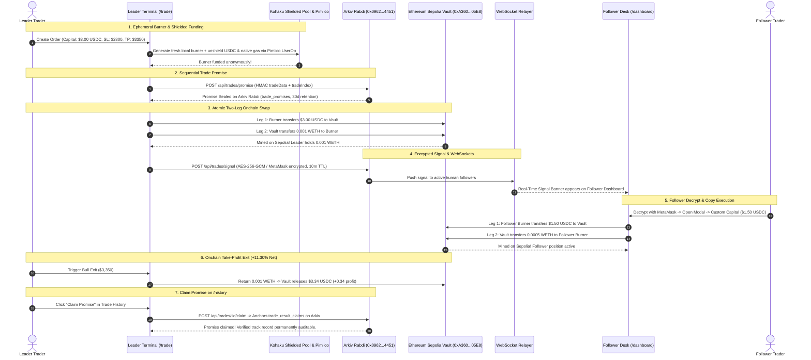
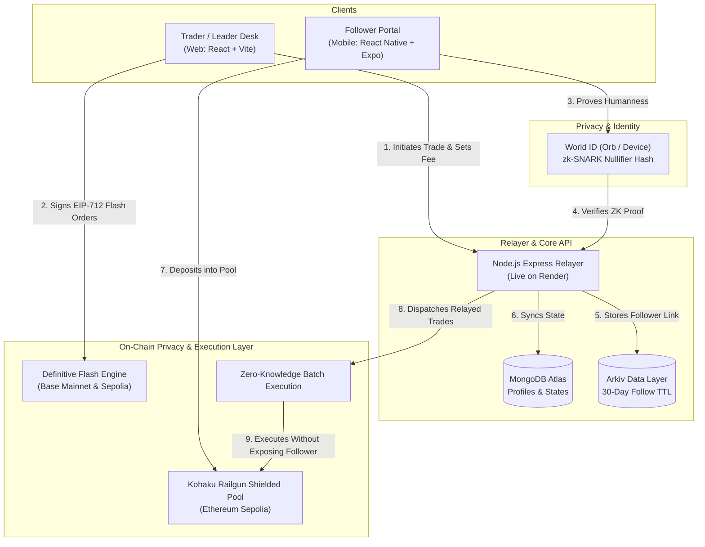

# 🛡️ Syndicate — Zero-Knowledge Copy Trading Protocol

> **Copy a trader's moves without broadcasting your capital.**  
> Built with **World ID (zk-SNARKs)**, **Kohaku (Railgun Shielded Pool)**, **Definitive Flash**, and **Arkiv**.

---

## ⚡ Quick Demo: Flash Trade Terminal & Live Social Copy Engine

- **Stand-alone Flash Terminal (No Login Required):** **[`http://localhost:5173/flash-trade`](http://localhost:5173/flash-trade)**
- **Ranked Trader Leaderboard & Equity Curves:** **[`http://localhost:5173/leaderboard`](http://localhost:5173/leaderboard)**
- **Social Trade Commentary Feed:** **[`http://localhost:5173/feed`](http://localhost:5173/feed)**
- **Leader Trading Desk (Authenticated):** **[`http://localhost:5173/trade`](http://localhost:5173/trade)**
- **Follower Dashboard & Shielded Funds:** **[`http://localhost:5173/dashboard`](http://localhost:5173/dashboard)**
- **Trade History, Receipts & Promise Claims:** **[`http://localhost:5173/history`](http://localhost:5173/history)**
- **Leader Discovery & Risk Profiles:** **[`http://localhost:5173/explore`](http://localhost:5173/explore)**

For ETHGlobal Mumbai hackathon evaluation, SyndicateCopy features live onchain execution on **Ethereum Sepolia** and **Arkiv Rabdi Testnet** with zero-knowledge shielded privacy:
- **Shielded Funds Management:** Deposit ETH, USDC, or WETH from MetaMask into a persistent Kohaku/Railgun shielded wallet (derivation in localStorage, note database in IndexedDB) with full backup and restore.
- **Leader Shielded Funding & Ephemeral Burners:** Generates fresh local ephemeral burner keypairs on the leader's device, pre-verifies proving artifacts, and submits EIP-7702 UserOperations via Pimlico bundler to unshield USDC + native ETH execution gas.
- **Sequential Trade Promises:** Hashed and sealed onto **Arkiv Rabdi Testnet** (`trade_promises`) with 30-day immutable audit retention.
- **Bracket Orders & Definitive Flash:** Entry + Take-Profit + Stop-Loss in 1 signed intent ($0 gas EIP-712).
- **Two-Leg Atomic Onchain Swaps:** Real transfers of USDC $\leftrightarrow$ WETH with FlashTradePool Vault on Ethereum Sepolia.
- **Dedicated Burner Partitioning:** Isolated burner accounts for Leaders (`0x2e5B...57F9`) and Followers (`0x915E...3AF6`) preventing balance conflation.
- **Encrypted Signal TTL:** Trade signals encrypted with follower public keys (MetaMask ECIES / AES-256-GCM) with a 10-minute auto-expiring TTL on Arkiv, backed by a WebSocket real-time delivery and decryption key recovery.
- **Trade History & Verified P/L:** Inspect verified onchain entry/exit transaction hashes, realized USDC P/L, and gas costs separately.
- **Arkiv Claim Promise (`trade_result_claims`):** Post-trade audit attestation linking completed, receipt-verified results directly to pre-trade promises on Arkiv.
- **Production Mode:** Definitive Flash on Base Mainnet (Sub-second execution, $0 gas EIP-712 offchain signatures).

📖 **Read the Full Technical Documentation & Architecture FAQ:** [FLASH_TRADE_DOCS.md](./FLASH_TRADE_DOCS.md) | [PROJECT_SUMMARY.md](./PROJECT_SUMMARY.md) | [TRADE_HISTORY.md](./TRADE_HISTORY.md) | [SHIELDED_FUNDS.md](./frontend/SHIELDED_FUNDS.md)

---

## 🔑 Preloaded Testnet Credentials (Judges Reference)

All accounts are pre-configured in code and pre-funded with testnet ETH, USDC, and tGLM:

| Role | Wallet Address | Network | Starting Balance | Private Key / Purpose |
|---|---|---|---|---|
| **Leader Burner** | [`0x2e5Bade58a9D3C939C45269AfC5b0e26b66b57F9`](https://sepolia.etherscan.io/address/0x2e5Bade58a9D3C939C45269AfC5b0e26b66b57F9) | Ethereum Sepolia | `20.17 USDC`<br>`0.0075 ETH` | `0x188fe782457952a2218796912dafea24d0554d167afd17796d576faa77633875`<br>*Executes leader bracket trades & exits* |
| **Follower Burner** | [`0x915E5004F52F934717D8938638A991470FE03AF6`](https://sepolia.etherscan.io/address/0x915E5004F52F934717D8938638A991470FE03AF6) | Ethereum Sepolia | `15.00 USDC`<br>`0.004 ETH` | `0xec21abb2f5c1838d80d40ecc8608e4c88ecf5bfd824f6eee35dc2a450e224fec`<br>*Executes follower copy trades & exits* |
| **FlashTradePool Vault** | [`0xA360946725811DABB91C054A3DFF25eD25C005E8`](https://sepolia.etherscan.io/address/0xA360946725811DABB91C054A3DFF25eD25C005E8) | Ethereum Sepolia | `38.83 USDC`<br>`0.019 WETH` | `0x5299ad8d435a01383b00d555c4414186ace307e42f42991ba08a83505cb3ed6b`<br>*Automated onchain counterparty pool* |
| **Arkiv Relayer & Signer** | [`0x0962cC66c69426C32574447cF50fe9664fE94451`](https://rabdi.explorer.arkiv.network/address/0x0962cC66c69426C32574447cF50fe9664fE94451) | Arkiv Rabdi Testnet | `10.0 tGLM` | Derived from `SIGNER_KEY`<br>*Broadcasts onchain Arkiv entities & World ID rp_context* |

---

## 🔄 End-to-End User Journey (Leader Promise &rarr; Follower Copy &rarr; Claim)



---

## 🛠️ Technology Stack

| Layer | Technology | Details |
|---|---|---|
| **Frontend Web Desk** | React 19 + Vite + TypeScript + Tailwind | Leader execution terminal, performance analytics |
| **Follower Mobile App** | React Native + Expo SDK 58 | 1-tap World ID login, shielded balance, copy modal |
| **Execution Engine** | Definitive Flash Advanced Orders | Bracket orders (TP + SL), TWAP, RFQ solver relay |
| **Privacy Layer** | Kohaku / Railgun Shielded Pool | Zero-link anonymous burner funding on Ethereum Sepolia |
| **Onchain Networks** | Ethereum Sepolia (L1) & Base Mainnet (L2) | Chain IDs: `11155111` (Privacy/Dev) & `8453` (Prod) |
| **Data Anchoring** | Arkiv Protocol | Decentralized 30-day follower relationship storage |
| **Identity Verification** | World ID v4 (`@worldcoin/idkit`) | Orb / Device zk-SNARK humanness verification |
| **Backend & Relayer** | Node.js + Express (ESM) | WebSocket real-time trade signals, live on Render |
| **Database** | MongoDB Atlas (Mongoose) | User profiles, nullifier mapping, trade state |

---

## ⚡ The Problem

* **MEV & Front-Running:** Traditional on-chain copy-trading publicly broadcasts follower wallet addresses, making followers easy targets for sandwich bots and front-runners.
* **Alpha Degradation:** Elite traders cannot monetize their strategies without exposing their wallet history and trade timing to copycat scrapers.
* **Sybil & Bot Farms:** Fake accounts and automated bots manipulate leaderboards and distort social copy-trading metrics.

---

## 💡 The Solution

1. **Shielded Pool Execution:** Follower funds reside in a private **Kohaku Railgun shielded pool**. Moves execute via ZK-relayer batches with zero public balance linkage.
2. **Definitive Flash Execution:** Leaders and followers execute advanced **Bracket Orders** (Take-Profit + Stop-Loss) and **TWAP split orders** with $0 gas offchain EIP-712 intent signatures.
3. **Sybil-Resistant Identity:** Followers authenticate via **World ID** zero-knowledge proofs (1 Human = 1 Seat) with zero personal data or KYC.
4. **Decentralized Relationship Anchoring:** Follower subscriptions are recorded on **Arkiv** with cryptographic 30-day TTLs.
5. **Separation of Concerns:**
   * **Web Desk (`frontend`):** Designed for **Leaders** — detailed execution, performance charts, and fee management.
   * **Mobile App (`app`):** Designed for **Followers** — 1-tap World ID login, shielded balance control, and mobile copy allocation.

---

## 🏛️ System Architecture



---

## 📂 Repository Structure

```
syndicate/
├── app/               # 📱 Follower Mobile Client (React Native + Expo SDK 58)
│   ├── src/
│   │   ├── api/       # Client communicating with live Render backend
│   │   ├── context/   # AuthContext, TradeContext, ThemeContext
│   │   ├── screens/   # Minimalist Login, Follower Dashboard, Discover, Profile
│   │   └── components/# ShieldedBalanceCard, CopyModal (Action Sheet)
│   └── App.tsx        # Dynamic safe-area navigator with Light/Dark mode
│
├── frontend/          # 💻 Leader / Trader Web Desk (React 19 + Vite + Tailwind)
│   ├── src/
│   │   ├── pages/     # Dashboard, Leaderboard, Feed, Explore, Terminal, FlashTrade, Profile
│   │   ├── components/# Navbar, WalletConnectButton, WorldIDButton, TradeSignalBanner
│   │   └── lib/       # Arkiv network, Viem Base / Sepolia & Definitive client
│   └── index.html
│
└── backend/           # ⚙️ Relayer & Core API (Node.js ESM + Express)
    ├── src/
    │   ├── routes/    # /api/auth, /api/user, /api/explore, /api/follow, /api/trade, /api/posts
    │   ├── services/  # arkiv.js, statsCalculator.js, tradeCrypto.js
    │   └── models/    # User.js, Follow.js, SocialFollow.js, Trade.js, TradePost.js, LeaderStatsSnapshot.js
    └── render.yaml    # Production deployment blueprint for Render
```

---

## 🚀 Quick Start

### 1. Backend (`syndicate/backend`)
```bash
cd backend
npm install
npm run dev    # Local: http://localhost:3001 | Production: Render
```

### 2. Leader Web Desk (`syndicate/frontend`)
```bash
cd frontend
npm install
npm run dev    # Opens at http://localhost:5173
```

### 3. Follower Mobile App (`syndicate/app`)
```bash
cd app
npm install
npx expo start # Scan QR code with Expo Go or press 'w' for web view
```

---

## 📜 Production Endpoints

* **Backend API (Render):** `https://syndicate-backend-n3p9.onrender.com`
* **Health Check:** `https://syndicate-backend-n3p9.onrender.com/health`
* **World ID Auth Context:** `https://syndicate-backend-n3p9.onrender.com/api/auth/rp-context`

---

## 📦 Arkiv Protocol Integration (Judges Evaluation)

* **Network:** Arkiv Rabdi Testnet
* **Writing Relayer Address:** [`0x0962cC66c69426C32574447cF50fe9664fE94451`](https://rabdi.explorer.arkiv.network/address/0x0962cC66c69426C32574447cF50fe9664fE94451)
* **Arkiv Rabdi Explorer:** [`https://rabdi.explorer.arkiv.network/entity-explorer`](https://rabdi.explorer.arkiv.network/entity-explorer)

### 📑 Arkiv Track Documentation (25% Scoring Breakdown):
1. [Schema Definitions (`arkiv/schema.md`)](./arkiv/schema.md) — 4 active schemas: `follower_relationships` (30d TTL), `trade_signals` (10m TTL), `trade_promises` (30d retention), and `trade_result_claims` (result attestation).
2. [How Syndicate Uses Arkiv (`arkiv/how-you-use-arkiv.md`)](./arkiv/how-you-use-arkiv.md) — Architecture, writing keys, runnable queries, and post-trade result claiming.
3. [Why Arkiv (`arkiv/why-arkiv.md`)](./arkiv/why-arkiv.md) — Ephemeral state coordination vs. permanent L1 bloat.
4. [Developer Friction & Feedback (`arkiv/friction.md`)](./arkiv/friction.md) — Actionable feedback on the SDK, schema builders, and emulator needs.
5. [Ecosystem Reach (`arkiv/reach.md`)](./arkiv/reach.md) — Scaling to thousands of trading guilds and volume projections.

---

## 🧪 Automated Test Suite & Verification

SyndicateCopy maintains automated test coverage across frontend shielded operations, artifact caching, RPC stability, and backend claim verification:

```bash
# 1. Run frontend unit & boundary tests (Vitest: 8 test files, 27 tests passing)
npm test --prefix frontend

# 2. Run backend API, session proxy & claim verification tests (Node test runner)
node --test backend/tests/*.js

# 3. Verify proving artifact preparation (Self-hosted 75 files, ~179 MB pinned Git blob revision)
npm run artifacts:prepare --prefix frontend
```

---

## 🛡️ Ethereum Foundation CROPS Framework

* **Confidentiality:** Follower trade allocations and notes reside in a Kohaku Railgun zero-knowledge shielded pool.
* **Ownership:** Leaders and followers hold self-custodied keys; trades execute via client-side ephemeral burner wallets.
* **Privacy:** Trade moves are executed through unlinked single-use burners; outsiders cannot correlate a trader to their funding source.
* **Scalability:** Offchain EIP-712 intent authorization on Definitive Flash paired with Base L2 execution eliminates gas friction.

