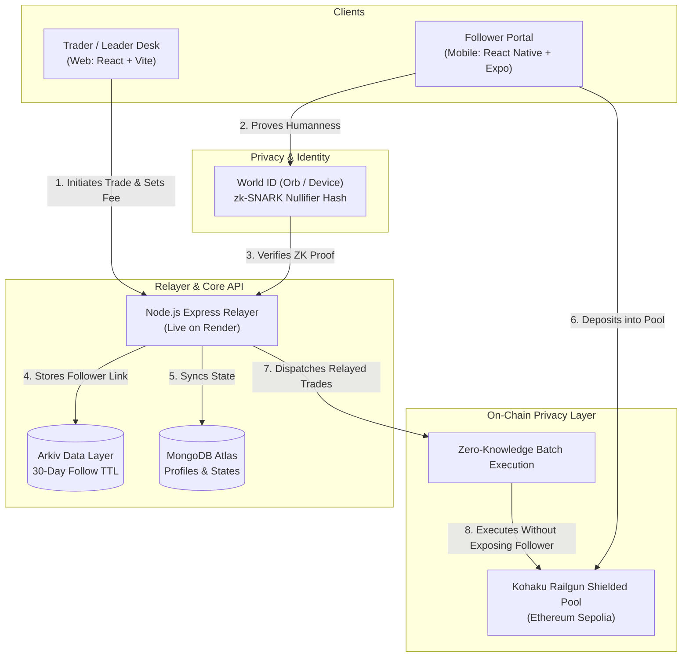

# 🛡️ Syndicate — Zero-Knowledge Copy Trading Protocol

> **Copy a trader's moves without broadcasting your capital.**  
> Built with **World ID (zk-SNARKs)**, **Kohaku (Railgun Shielded Pool)**, and **Arkiv**.

---

## ⚡ The Problem

* **MEV & Front-Running:** Traditional on-chain copy-trading publicly broadcasts follower wallet addresses, making followers easy targets for sandwich bots and front-runners.
* **Alpha Degradation:** Elite traders cannot monetize their strategies without exposing their wallet history and trade timing to copycat scrapers.
* **Sybil & Bot Farms:** Fake accounts and automated bots manipulate leaderboards and distort social copy-trading metrics.

---

## 💡 The Solution

1. **Shielded Pool Execution:** Follower funds reside in a private **Kohaku Railgun shielded pool**. Moves execute via ZK-relayer batches with zero public balance linkage.
2. **Sybil-Resistant Identity:** Followers authenticate via **World ID** zero-knowledge proofs (1 Human = 1 Seat) with zero personal data or KYC.
3. **Decentralized Relationship Anchoring:** Follower subscriptions are recorded on **Arkiv** with cryptographic 30-day TTLs.
4. **Separation of Concerns:**
   * **Web Desk (`frontend`):** Designed for **Leaders** — detailed execution, performance charts, and fee management.
   * **Mobile App (`app`):** Designed for **Followers** — 1-tap World ID login, shielded balance control, and mobile copy allocation.

---

## 🏛️ System Architecture



---

## 📂 Repository Structure

```
syndicate/
├── app/               # 📱 Follower Mobile Client (React Native + Expo SDK 58)
│   ├── src/
│   │   ├── api/       # Client communicating with live Render backend
│   │   ├── context/   # AuthContext, TradeContext, ThemeContext
│   │   ├── screens/   # Minimalist Login, Follower Dashboard, Discover, Profile
│   │   └── components/# ShieldedBalanceCard, CopyModal (Action Sheet)
│   └── App.tsx        # Dynamic safe-area navigator with Light/Dark mode
│
├── frontend/          # 💻 Leader / Trader Web Desk (React 19 + Vite + Tailwind)
│   ├── src/
│   │   ├── pages/     # Landing, Dashboard, Explore Leaders, Profile
│   │   ├── components/# Navbar, WalletConnectButton, WorldIDButton
│   │   └── lib/       # Arkiv network & Viem Base Sepolia helpers
│   └── index.html
│
└── backend/           # ⚙️ Relayer & Core API (Node.js ESM + Express)
    ├── src/
    │   ├── routes/    # /api/auth, /api/user, /api/explore, /api/follow
    │   ├── services/  # arkiv.js (Decentralized follower relationship storage)
    │   └── models/    # User.js, Follow.js (Mongoose)
    └── render.yaml    # Production deployment blueprint for Render
```

---

## 🚀 Quick Start

### 1. Backend (`syndicate/backend`)
```bash
cd backend
npm install
npm run dev    # Local: http://localhost:3001 | Production: Render
```

### 2. Leader Web Desk (`syndicate/frontend`)
```bash
cd frontend
npm install
npm run dev    # Opens at http://localhost:5173
```

### 3. Follower Mobile App (`syndicate/app`)
```bash
cd app
npm install
npx expo start # Scan QR code with Expo Go or press 'w' for web view
```

---

## 📜 Production Endpoints

* **Backend API (Render):** `https://syndicate-backend-n3p9.onrender.com`
* **Health Check:** `https://syndicate-backend-n3p9.onrender.com/health`
* **World ID Auth Context:** `https://syndicate-backend-n3p9.onrender.com/api/auth/rp-context`
