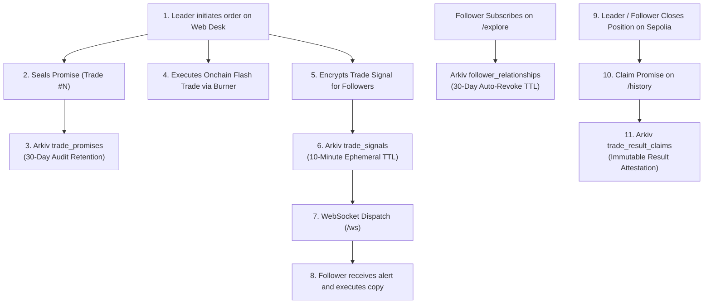

# 🏗️ How SyndicateCopy Uses Arkiv

SyndicateCopy uses **Arkiv** as its verifiable decentralized data anchoring and ephemeral state coordination layer.

---

## 🔑 Writing Wallet & Network Details

* **Target Network:** Arkiv Rabdi Testnet
* **Writing Relayer Address:** `0x0962cC66c69426C32574447cF50fe9664fE94451`
* **Explorer URL:** `https://rabdi.explorer.arkiv.network/entity-explorer`

---

## 🏛️ Architecture & Data Flow



---

## 🛠️ Runnable Query Example (Judge Verification)

Judges can verify our records on the Arkiv Rabdi testnet using the official `@arkiv-network/sdk`.

### Run via Node.js script:

```typescript
import { createPublicClient } from '@arkiv-network/sdk';
import { rabdi } from '@arkiv-network/sdk/chains';
import { http } from 'viem';
import { TradePromiseSchema } from './arkiv/schema.js';

// 1. Initialize Arkiv public reader client
const client = createPublicClient({
  chain: rabdi({ accessKey: process.env.ARKIV_ACCESS_KEY || '' }),
  transport: http(),
});

// 2. Query sealed trade promises written by our relayer
async function queryTradePromises() {
  const relayerAddress = '0x0962cC66c69426C32574447cF50fe9664fE94451';
  
  console.log(`Querying sealed promises for relayer ${relayerAddress}...`);
  
  const entities = await client.queryEntities(TradePromiseSchema, {
    where: {
      leaderPublicKey: relayerAddress.toLowerCase(),
    },
    limit: 10,
  });

  console.log(`Found ${entities.length} verified trade promises on Arkiv Rabdi!`);
  entities.forEach((entity, idx) => {
    console.log(`\n--- Promise #${idx + 1} ---`);
    console.log(`Trade Index: #${entity.tradeIndex}`);
    console.log(`Promise ID: ${entity.promiseId}`);
    console.log(`Payload Hash: ${entity.payloadHash}`);
    console.log(`Timestamp: ${entity.timestamp}`);
    console.log(`Arkiv Entity Key: ${entity.entityKey}`);
  });
}

queryTradePromises().catch(console.error);
```

